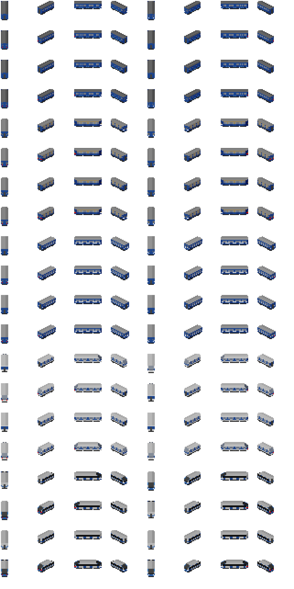

# OpenTTD Underground Metro Set

A small NewGRF for OpenTTD Underground: five generations of metro cars and
the metro track they run on. Install it and build a metro without
downloading anything else.

## Contents

* **Metro track** (railtype label `MTRO`): ordinary track with a thin yellow
  conductor rail beside one running rail. Own sprites for plain track,
  slopes, junctions, crossings of two tracks, level crossings with roads,
  tunnel entrances, bridge decks, depots, the build toolbar icons and
  cursors, and a yellow minimap colour. No speed limit, the price of
  electrified rail, available from the start of any game. Signals and fences
  are the base set ones.
* **Metro cars**. Every car is a self-propelled electric multiple unit car
  (all of them are engines) on metro track only; ordinary trains do not run
  on metro track and metro cars do not run on ordinary rail. A car is a
  full-length OpenTTD vehicle (length 8 of 8 = half a tile). The cars at
  both ends of a train are drawn with a cab, the cars in the middle without
  (the 714 never has a cab). Passengers only, fast loading.

The track sprites keep the gauge, sleeper width and rail positions of the
base set track (OpenGFX) so trains of both kinds stand on it the same way;
the only addition is the 1 pixel conductor rail. A railtype cannot draw "the
base set track plus an overlay": as soon as it brings its own track overlay
it has to bring its own ground sprites too, so the set draws them itself.

## Assembling a train

Buy a car in a metro depot, buy more cars of the same type and drag each
one onto the first (in the depot window). Typical trains: 4 to 8 cars of
`Type A`, `Type E`, `720` or `765`; for the `717` put a `717` at both ends
and `714` cars in the middle. Clone the finished train with the "Clone
train" button of the depot.

## The cars

| Prototype | In game | Year | Design speed | Capacity in game (nominal) | Power per car | Mass | Life | Sources |
|---|---|---|---|---|---|---|---|---|
| Moscow metro type A (1934-1937) | Type A | 1935 | 65 km/h | 147 | 306 kW (*) | 44 t (*) | 40 years | [ru.wikipedia: A](https://ru.wikipedia.org/wiki/А_(вагон_метро)) |
| type E (1959, serial 1963-1969) | Type E | 1959 | 90 km/h | 148 | 272 kW (4 x 68) | 32 t | 40 years | [ru.wikipedia: E](https://ru.wikipedia.org/wiki/Е_(вагон_метро)) |
| 81-717 (head car, 1976) | 717 | 1976 | 90 km/h | 173 | 456 kW (4 x 114) | 34 t | 40 years | [ru.wikipedia: 81-717/714](https://ru.wikipedia.org/wiki/81-717/714) |
| 81-714 (intermediate car) | 714 | 1976 | 90 km/h | 173 | 456 kW (4 x 114) | 34 t | 40 years | same |
| 81-720/721 (1991, in service 1998) | 720 | 1991 | 100 km/h | 185 | 460 kW (4 x 115) | 35 t | 25 years | [ru.wikipedia: 81-720/721](https://ru.wikipedia.org/wiki/81-720/721) |
| 81-765 (2016) | 765 | 2016 | 90 km/h | 176 | 680 kW (4 x 170) | 38 t | 30 years | [ru.wikipedia: 81-765/766/767](https://ru.wikipedia.org/wiki/81-765/766/767) |

Only figures were taken from the sources (no text, drawings or pictures);
the look of the cars is our own, in the spirit of each era.

(*) The 1935 trains were motor car + trailer pairs (motor car 4 x 153 kW,
51.7 t; trailer 36 t). In this set every car is a motor car, so a car has
the average of the pair.

**Capacity** is the nominal load: seats plus standing at about 5 persons per
m2, not the crush load. Where the source only gives the full load (at about
10 persons per m2) the nominal load is 56 % of it, the ratio of the two
published figures of the 765 (176 / 315). No further scaling.

**Balance.** A car costs about as much as a passenger locomotive of its time
(cost factor 16-25 of the train base price) and has the running cost of an
electric locomotive (factor 85-105): per passenger seat that is in line with
a standard passenger train of the era, so a metro is not a money machine on
the surface. Loading speed 20-32 (standard carriages: 5). Model life: the
type A is on sale for 30 years, the E 27, the 717/714 45, the 720 15 years,
the 765 does not expire.

## Building

Needs Python 3 with Pillow and numpy, and NML 0.8 (`pip install nml`). From
this folder:

    python generate.py                              # sprites (gfx/*.png), metro_set.nml, docs/preview*.png
    nmlc -c --grf=metro_set.grf metro_set.nml      # the NewGRF (-c: crop the sprites)
    python generate.py --fix-grf metro_set.grf      # a valid default group for the railtype

or run `build.ps1` (Windows) / `build.sh`. `generate.py` reads the TTD
palette from `../baseset/openttd/openttdgui.png`. `metro_set.nml` and the
sprite sheets are generated: change the tables in `generate.py` (cars) and
`track_art.py` (track) instead.

## Installing

Copy `metro_set.grf` into the `newgrf` folder of OpenTTD (for example
`Documents\OpenTTD\newgrf` on Windows, `~/.local/share/openttd/newgrf` on
Linux, or the `newgrf` folder next to the game executable), then in the main
menu open "NewGRF Settings", add "OpenTTD Underground Metro Set" and apply.
It works in every climate.

## License

GPL version 2, the license of OpenTTD (see `COPYING.md` at the top of the
repository). All sprites are drawn by `generate.py` and `track_art.py`; no
graphics or code of other NewGRF sets were used.
